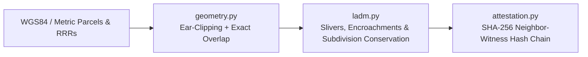

# cadastre-kit

[](https://github.com/codesphere-u/cadastre-kit/actions/workflows/ci.yml)
[](LICENSE)
[](pyproject.toml)
[](pyproject.toml)

**Zero-dependency ISO 19152 LADM parcel topology validator, ear-clipping overlap & GPS sliver detector, subdivision area-conservation auditor, and neighbor-witness cryptographic attestation ledger.**

- **Mission Domain:** Governance, Land Rights & Customary Tenure
- **Stack:** Pure Python 3.11+ (zero runtime third-party dependencies, `mypy --strict`, `ruff`, `pytest`)
- **Maintainer:** Codesphere Innovations (U) Limited (`codesphere-u`)

---

## Problem Solved

Land boundary overlaps, fraudulent subdivision inflation, and unrecorded customary boundaries drive massive civil litigation across Africa, while enterprise GIS stacks require heavy C/GDAL dependencies.

## Key Features

- Zero-dependency computational geometry (`geometry.py`): WGS84 local tangent-plane metric projection, exact bow-tie self-intersection detection, ear-clipping triangulation for concave/convex polygons, and exact Sutherland-Hodgman overlap areas.
- ISO 19152 LADM parcel & RRR model (`ladm.py`): separates GPS drift slivers from material encroachments, enforces ownership share sums (`== 1.0`), and audits subdivision area conservation & containment.
- Append-only SHA-256 hash-chained neighbor-witness boundary attestation ledger (`WitnessAttestationLedger`) with quorum checks and full-chain tamper verification.

## Architecture Overview



See [docs/architecture.md](docs/architecture.md) for module-level design details.

## Installation

```bash
git clone https://github.com/codesphere-u/cadastre-kit.git
cd cadastre-kit
uv sync --extra dev
```

Or install in editable mode with standard `pip`:

```bash
pip install -e ".[dev]"
```

## Quick Start (CLI)

```bash
cadastre-kit parcels.json --sliver-m2 5.0
```

## Quick Start (Python API)

```python
from cadastre_kit import Parcel, TenureType, audit_cadastre_topology

p1 = Parcel('P1', TenureType.CUSTOMARY, ((0, 0), (50, 0), (50, 40), (0, 40)))
p2 = Parcel('P2', TenureType.CUSTOMARY, ((45, 0), (100, 0), (100, 40), (45, 40)))
findings = audit_cadastre_topology([p1, p2])
assert findings[0].code == 'BOUNDARY_ENCROACHMENT'
```

## Testing & Quality Gates

```bash
uv run ruff check src tests
uv run mypy src
uv run pytest -v
```

## Security, Contributing & Roadmap

- **Security:** See [SECURITY.md](SECURITY.md) for responsible disclosure procedures.
- **Contributing:** See [CONTRIBUTING.md](CONTRIBUTING.md) and [CODE_OF_CONDUCT.md](CODE_OF_CONDUCT.md).
- **Changelog & Roadmap:** See [CHANGELOG.md](CHANGELOG.md) and [ROADMAP.md](ROADMAP.md).

## License

MIT License — see [LICENSE](LICENSE).

## Support & Contact

Open an issue on [GitHub Issues](https://github.com/codesphere-u/cadastre-kit/issues) or contact `codesphereinnovationz@gmail.com`.
